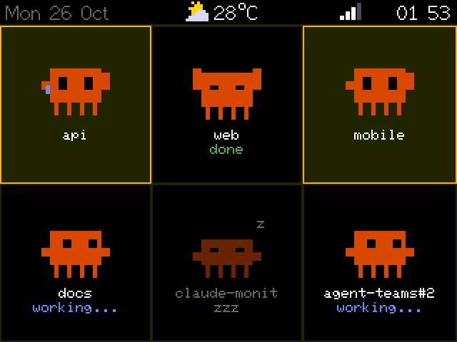
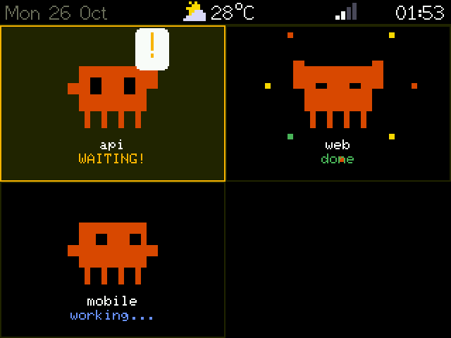
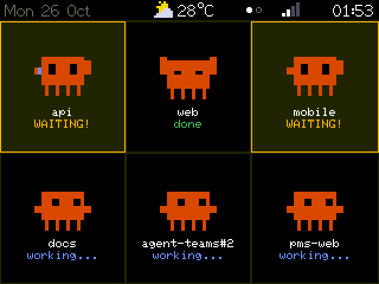
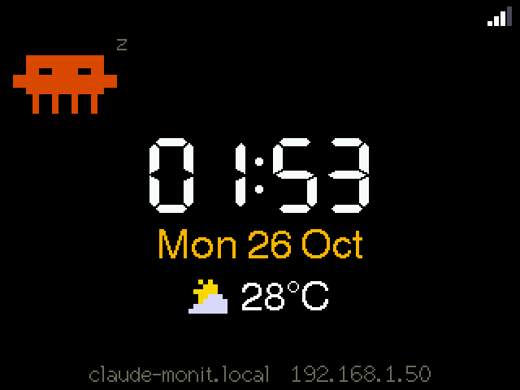

# claude-monit

<p align="center"></p>

A desk display for Claude Code on an ESP32-2432S028 ("Cheap Yellow Display"). Each Claude Code session gets its own animated pixel-art Clawd. The board shows which session is **waiting for permission** and which is **done**, and the RGB LED blinks to get your attention.

```
Claude Code sessions ──hooks──▶ hook/claude-monit-hook.js ──HTTP──▶ ESP32 (claude-monit.local)
                                   └─ ~/.claude-monit/sessions/*.json
```

## What the screen shows

| State | Slot | Clawd | LED |
|---|---|---|---|
| waiting for permission | orange background, `WAITING!` blinks | waves | orange, blinking |
| done | green `done` | jumps | green flash once a second |
| working | blue `working...` | bobs | off |
| idle | dimmed `zzz` | sleeps | off |

- **Status bar:** date, local weather (Open-Meteo, every 15 min), WiFi signal and time (NTP). Location and timezone are set in `platformio.ini` (Bangkok by default).
- **No sessions:** the board turns into a desk clock, with Clawd strolling across, looking up at the clock and napping.
- **Up to 6 slots per page.** With more sessions, pages advance every 8 s (15 s on page 1 while something waits), and dots in the status bar show the page. Waiting and done sessions are always on page 1.
- **Effects:** a `!` bubble pops up when a session starts waiting, and a pixel burst plays when one finishes. After 5 minutes of waiting, Clawd waves faster and the frame blinks; after 15 minutes it starts sweating.

| A new permission request and a finished session | More than six sessions: page dots | Nothing open: desk clock |
|---|---|---|
|  |  |  |

Every image is a real frame read from the board's frame buffer. To refresh them, run `python3 tools/screenshots.py [board-ip]`. It shows staged sessions on the board for about a minute; the live sessions come back on the next hook event.

### Touch

On this board the touch panel only reports *that* it is pressed, not *where*.

- **Tap:** acknowledges every waiting/done session at once (they go idle and the LED turns off). If a details page is open, a tap closes it.
- **Double tap:** goes to the next page.
- **Hold (about 0.6 s):** opens the details page for the most urgent session: how long it has been waiting, the tool it wants (e.g. `Bash`) and its folder. Hold again to step to the next session.

## Setup

### What you need

- **Board:** an ESP32-2432S028R ("Cheap Yellow Display"). It was built on the USB-C variant (sometimes sold as "CYD2USB"); other variants may need the display tweaks under [Troubleshooting](#troubleshooting).
- **WiFi:** a 2.4 GHz network (the ESP32 has no 5 GHz radio), the same network your computer is on.
- **Computer:** macOS. The hook should work on Linux too but is only tested on macOS.
- **[Node.js](https://nodejs.org) 18 or newer** for the hook.
- **[PlatformIO](https://platformio.org/install/cli)** for the firmware: `brew install platformio` on macOS, or `pipx install platformio`.
- A USB data cable. If the board does not show up, install the USB serial driver for its chip (CH340 or CP210x).

### 1. Get the code

```bash
git clone https://github.com/itseed/claude-monit.git ~/claude-monit
cd ~/claude-monit
```

Keep the clone where it is: the hook runs straight from this folder. If you move it, run `node hook/install.js` again from the new place.

### 2. Set your location

The status bar shows weather and time for Bangkok by default. Change these three lines in `platformio.ini` to your own:

```ini
    -DWEATHER_LAT=13.7563
    -DWEATHER_LON=100.5018
    '-DTZ_POSIX="ICT-7"'
```

`TZ_POSIX` is a POSIX timezone string, e.g. `"CET-1CEST,M3.5.0,M10.5.0/3"` for Berlin or `"PST8PDT,M3.2.0,M11.1.0"` for Los Angeles ([full list](https://github.com/nayarsystems/posix_tz_db/blob/master/zones.csv)).

### 3. Flash the firmware

Plug the board in and run:

```bash
pio run -e cyd -t upload
```

PlatformIO finds the serial port by itself; if more than one is connected, add `--upload-port /dev/cu.usbserial-XXXX` (`pio device list` shows them). The first build downloads the ESP32 toolchain and takes a few minutes.

### 4. Connect the board to WiFi

On first boot the board opens an access point called **`claude-monit-setup`**:

1. Join it from your phone.
2. Open `http://192.168.4.1` if the portal does not pop up.
3. Choose your WiFi network and enter its password.

The portal stays open for 3 minutes; after that the board restarts and opens it again. The board remembers the network. To move it to a different network, power it up where the saved network is out of range and it will open the portal again, or wipe it completely with `pio run -e cyd -t erase` and flash again.

### 5. Install the Claude Code hook

```bash
node hook/install.js              # adds entries to ~/.claude/settings.json
```

- The installer keeps every existing hook.
- It saves a backup to `~/.claude/settings.json.claude-monit.bak` before writing.
- Running it twice does not add duplicate entries.

Start a new Claude Code session (sessions that were already open before the install will not report). A Clawd should appear on the board within a second. If not, see [Troubleshooting](#troubleshooting).

To remove it:

```bash
node hook/install.js --uninstall  # removes only claude-monit's entries
rm -rf ~/.claude-monit            # session files and settings the hook kept
```

### Try it without WiFi

`pio run -e cyd_demo -t upload` flashes a demo that cycles fake sessions with no WiFi or hook. It replaces the real firmware; flash `-e cyd` again afterwards.

## Troubleshooting

**The hook cannot reach `claude-monit.local`.** Some routers block mDNS. Point the hook at the board's IP, shown under the clock when no sessions are open:

```bash
mkdir -p ~/.claude-monit
echo '{"host":"192.168.1.50"}' > ~/.claude-monit/config.json
# or per shell: export CLAUDE_MONIT_HOST=192.168.1.50
```

**The screen is white, mirrored, garbled or has inverted colors.** CYD boards come in several variants. In `platformio.ini`, try `-DILI9341_DRIVER` instead of `-DILI9341_2_DRIVER`, or remove `-DTFT_INVERSION_ON`, then flash again.

**Touch does nothing.** Only the touch interrupt (GPIO 36) is used, so any CYD should work; check `curl http://claude-monit.local/status` and see whether the press count goes up when you tap.

## Debugging

```bash
curl http://claude-monit.local/status     # sessions, LED mode, press count
curl -o screen.bmp http://claude-monit.local/screen.bmp   # what the screen shows right now
ls ~/.claude-monit/sessions/              # what the hook thinks each session is doing
```

The hook stays out of Claude Code's way:

- It exits right away and never prints anything.
- Sending happens in a detached background process.
- If the board is off, nothing slows down.
- After the board reboots, it catches up on the next hook event.

## Tests

```bash
pio test -e native        # board logic: sessions, expiry, layout, LED, clock, weather, gestures
(cd hook && node --test)  # hook: event mapping, naming, sender, installer
```

## Layout

| Path | What it holds |
|---|---|
| `lib/monit_core/` | Board logic with no hardware dependency, unit-tested on the Mac |
| `src/` | Display, Clawd sprites, WiFi/HTTP, LED, touch, weather |
| `hook/` | The Claude Code hook, the detached sender and the installer |
| `docs/superpowers/` | Design spec and implementation plan |

## Security

The board's HTTP endpoints have no authentication. Anyone on the same network can put sessions on the screen, and `/status` and `/screen.bmp` show your session names and folder paths. Use it on a home or office network you trust, not on public WiFi.

## Disclaimer

claude-monit is a personal project. It is not made by, affiliated with or endorsed by Anthropic. Claude, Claude Code and Clawd are Anthropic's.
